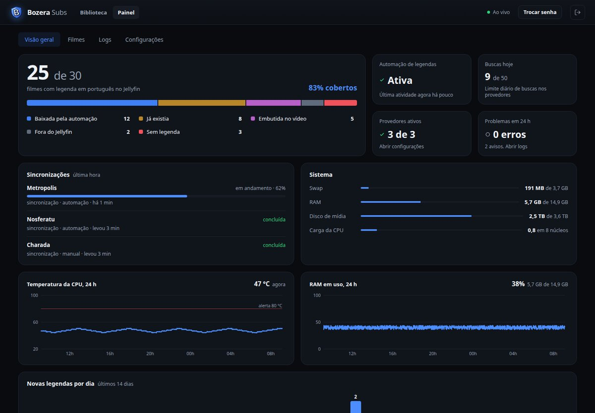
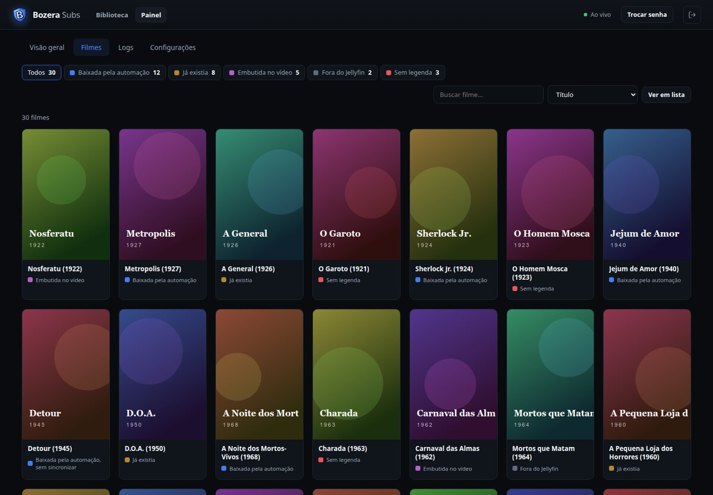
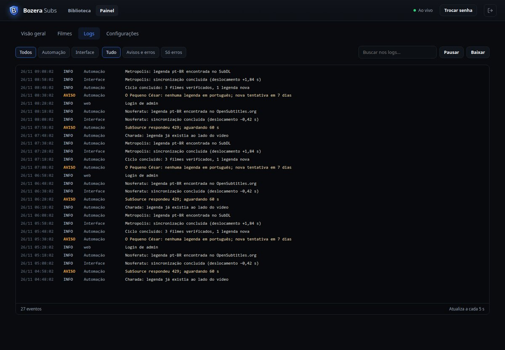

<p align="center"></p>
<h1 align="center">Bozera Subs</h1>

<p align="center"><b>Legendas em português para o seu Jellyfin, no automático e já sincronizadas.</b><br>
Busca, baixa, ajusta ao áudio do <i>seu</i> arquivo e mostra tudo num painel. Para quem mantém o próprio acervo.</p>

<p align="center"></p>

---

## O problema

O plugin de legendas do Jellyfin baixa a primeira legenda que encontra, e ela quase nunca bate com o seu arquivo: começa dois segundos antes, termina três depois, às vezes é de outra versão do filme. Aí você abre o player, ajusta o atraso na mão, e no próximo filme começa tudo de novo.

## O que o Bozera Subs faz

- 🔎 **Procura sozinho:** de tempos em tempos verifica a biblioteca e busca legenda **pt-BR** (ou pt-PT, se não houver) para os filmes que ainda não têm, no OpenSubtitles.org, no SubDL e no SubSource.
- 🎯 **Sincroniza com o áudio:** cada legenda baixada passa pelo [ffsubsync](https://github.com/smacke/ffsubsync), que escuta a trilha do **seu** arquivo e alinha as falas. O resultado vai para `<filme>.pt-BR.srt`, ao lado do vídeo, e o Jellyfin já enxerga.
- 🧠 **Escolhe com critério:**
  - pontua as candidatas pelo nome do lançamento;
  - recusa legenda incompleta (CD1/CD2) comparando a duração com a do vídeo;
  - confere a cobertura pela hora da última fala;
  - não repete busca sem motivo: um filme sem legenda só volta à fila depois de 7 dias, ou na hora, se você mudar os provedores.
- 📊 **Painel:**
  - cobertura da biblioteca;
  - sincronizações em andamento;
  - buscas do dia contra o limite configurado;
  - temperatura e RAM das últimas 24 h;
  - logs com filtro e download.
- 🎬 **Biblioteca com player e editor:** filmes **e séries**. Assista a um trecho no navegador, desloque a legenda em milissegundos ou rode a sincronização à mão. A busca automática, por enquanto, cobre os filmes.
- 🧙 **Instalação guiada:** um instalador de terminal descobre onde está o seu Jellyfin, e depois um wizard no navegador cria a conta e configura os provedores. Não há senha padrão.

<table>
<tr>
<td width="50%"></td>
<td width="50%"></td>
</tr>
</table>

<sub>Capturas com dados de demonstração (filmes em domínio público).</sub>

## Requisitos

- Docker com o plugin Compose.
- Python 3.9 ou mais novo no servidor, só para o instalador.
- Jellyfin 10.9 ou mais novo (cujo `jellyfin.db` tem a tabela `BaseItems`), instalado no sistema ou em Docker, **na mesma máquina**.
- Conta em pelo menos um provedor de legendas. Todos têm plano gratuito.

## Instalação

```bash
git clone https://github.com/pharaujojr/bozera-subs.git
cd bozera-subs
python3 setup.py
```

A instalação tem duas etapas:

1. **No terminal, `setup.py`:** detecta se o Jellyfin está instalado ou em Docker, encontra o banco, os metadados e as bibliotecas, e gera `.env`, `docker-compose.override.yml` e `data/config/install.json`. Ela roda fora do navegador porque o Docker só monta pastas ao criar os containers. Se o seu usuário não conseguir ler a pasta do Jellyfin, rode com `sudo`.
2. **No navegador:** abra o link mostrado no fim do `setup.py`. Ele contém um código de uso único que autoriza criar a conta de administrador. Depois disso, o wizard confere as permissões e configura os provedores.

Antes de a conta ser criada, tudo redireciona para o wizard.

## Provedores

Ficam em **Painel → Configurações**, onde também é possível testar cada provedor, apagar dados salvos e mudar o limite de buscas e o intervalo de verificação.

| Provedor | O que informar | Observação |
|---|---|---|
| [OpenSubtitles.org](https://www.opensubtitles.org) | Usuário e senha | A conta do opensubtitles.com é outra e não funciona |
| [SubDL](https://subdl.com) | Chave de API | |
| [SubSource](https://subsource.net) | Chave de API | |

Use as suas próprias contas e respeite os limites e os termos de cada provedor. O limite diário de buscas do painel existe para isso.

## Mudar pastas ou o Jellyfin

```bash
python3 setup.py
docker compose up -d
```

## Atualizar

```bash
git pull
docker compose up -d --build
```

## Onde ficam os dados

Tudo em `data/`, fora do Git:

| Caminho | Conteúdo | Quem acessa |
|---|---|---|
| `data/auth/auth.json` | Hash scrypt da senha | Só a interface |
| `data/config/install.json` | Caminhos do Jellyfin e da mídia | Interface e worker |
| `data/config/settings.json` | Provedores e chaves de API, em texto, com permissão 600 | Interface e worker |
| `data/worker/` | Estado, legendas originais e logs | Worker grava, interface lê |

## Segurança

- A interface usa HTTP puro. Para acessar de fora, coloque na frente um proxy com HTTPS ou use uma VPN como o Tailscale; não abra a porta direto na internet. Para limitar ao próprio servidor, defina `BIND_ADDRESS=127.0.0.1` no `.env`.
- Com 10 erros de login, o IP fica bloqueado por 15 minutos. Atrás de um proxy, todos os acessos podem aparecer com o mesmo IP.
- Quem faz login pode ler e gravar arquivos acessíveis ao container pela API do editor. Use só uma conta de confiança.
- O banco do Jellyfin é montado **somente leitura**. O Bozera Subs nunca escreve nele; as legendas vão para a pasta da mídia.

## Arquitetura

```
              ┌────────────── docker compose ──────────────┐
 navegador ──▶│  web (FastAPI)  ◀── redis ──▶  worker       │
              │   painel, wizard,              busca nos    │
              │   player, ffsubsync            provedores   │
              └──────┬───────────────────────────┬──────────┘
                     │ lê (ro)                    │ grava .pt-BR.srt
                jellyfin.db                   pasta da mídia ──▶ Jellyfin
```

```
app/        Interface web (FastAPI), painel, wizard, sincronização
worker/     Busca de legendas nos provedores
shared/     Configuração usada pelos dois
setup.py    Instalador de terminal
tests/      python3 -m unittest discover -s tests
```

## Licença

O código deste repositório está sob a **[licença MIT](LICENSE)**. Os componentes de terceiros mantêm as licenças próprias: veja o [CREDITS.md](CREDITS.md).

O projeto não tem relação com o Jellyfin nem com os provedores de legenda citados. É só um vizinho bem-intencionado.

## Créditos

O trabalho pesado é de outras pessoas: [ffsubsync](https://github.com/smacke/ffsubsync), [subliminal](https://github.com/Diaoul/subliminal), [FFmpeg](https://ffmpeg.org/), [FastAPI](https://github.com/fastapi/fastapi), [Redis](https://redis.io/) e, claro, o [Jellyfin](https://jellyfin.org/) e as comunidades que legendam filmes de graça. A lista completa está em **[CREDITS.md](CREDITS.md)**.
